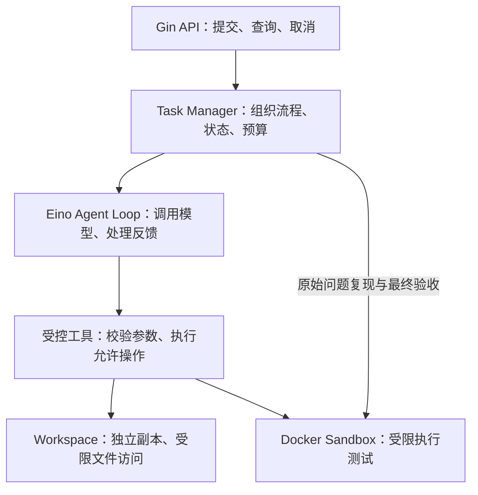

# CodePilot-Go 整体设计（MVP）

更新日期：2026-10-19。本文是项目全景图；表中的“计划”表示尚未实现，详细验收证据见 [开发进度](progress.md)。

## 1. 做成什么

用 Go、Gin、Eino 构建一个 Go 项目 Bug 修复后端。用户提交授权示例的标识和 Bug 描述，服务在独立副本中定位、修改、测试，返回任务状态、Diff/Patch、工具记录、测试结果与说明。

首版采用单进程、单 Agent、内存任务管理，同时执行一个修复任务；先跑通一个案例，再扩展固定案例集。

首个案例：判断整数是否属于闭区间 `[min, max]`，限定 `min <= max`。区间 `[1,5]` 应包含 1、3、5，不包含 0、6；当前示例错误地排除了右端点 5。

## 2. 模块怎样协作



箭头表示主要调用关系，工具结果沿调用链回传。图中包含规划能力，不代表这些模块已经接通。

| 模块 | 负责什么、交付什么 | 当前情况 |
|---|---|---|
| 服务入口 | 配置、日志、组件组装与启动 | 已有 `cmd/server` |
| HTTP API | 请求校验，提交、查询、取消任务 | 仅健康检查已实现 |
| Task Manager | 存储、队列、Context、状态；组织复现、修复、验收、清理及最终判定 | 计划中 |
| Agent Loop | 用 Eino 调用模型，处理工具反馈，在预算内迭代 | 仅最小工具调用验证已完成 |
| 受控工具 | 校验模型参数、权限及调用预算，执行 Go 操作，封装受限结果 | 任务工具适配层计划中 |
| Workspace | 独立副本与受限文件操作 | 副本、读写、列表、检索和 Diff 已通过用户验收 |
| Docker Sandbox | 固定测试命令，返回受限输出、退出码与超时信息 | 03 固定验证入口讲义已提供，真实接入与 Docker 验收待完成 |

**职责边界：** 模型提出操作，Go 程序校验并执行。Eino 承接模型和工具交互；权限、预算、状态和成功判定由外层程序实现。Workspace 和 Sandbox 提供独立能力，工具层负责向模型暴露它们；可信验收也能直接调用 Sandbox。

## 3. 目录怎样安排

以下相对于项目根目录。标为 `[计划]` 的目录和文件按对应批次落地，本设计不要求提前创建空目录。

```text
cmd/
  server/main.go          HTTP 服务入口；后续组装各模块
  agent-smoke/main.go     已有的最小模型工具调用验证程序
  sandbox-smoke/         [计划] 03 的固定沙箱复现入口与宿主测试
internal/
  httpapi/               [计划] 任务路由、请求及响应处理
  task/                  [计划] 任务存储、队列、执行流程、状态与结果判定
  agent/                 [计划] Eino 模型接入与有界修复循环
  tools/                 [计划] 文件和测试工具的参数校验、执行及输出封装
  workspace/             已有工作区源码与测试；包含 02 的 inspect 文件
  sandbox/               [计划] Docker 测试执行、超时、输出限制与容器清理
testdata/
  bugs/boundary/         已有 Bug 示例；独立 Go Module
  acceptance/            [计划] 可信端保存的固定验收测试
docs/
  architecture.md        本文：整体职责、流程与规划
  progress.md            实际实现与验收记录
  phase2-*.md            各功能批次的代码、讲解与验收步骤
  evaluation.md          [计划] 固定案例及真实评测结果
workspaces/              [计划] 运行时任务副本；已在 .gitignore 中排除
```

函数和文件随实现规模拆分；已有健康检查后续随任务路由一起整理到 `httpapi`。

## 4. 一次修复任务怎样走完

1. **接收。** 示例标识经外层白名单映射到可信源目录；队列有空位才接收，返回 `task_id`，客户端轮询查询。
2. **准备。** 从接收成功时计算总时限，排队与执行共享预算。Worker 取出任务后标记 `running`，创建副本并保管初始快照。
3. **复现。** 具备路径检查、最小沙箱、执行超时及迭代／重试上限后，首次在容器运行目标测试，确认预期失败；未复现则报告原因。
4. **修复。** Agent 列表、检索、读取，经工具修改允许文件。当前仅 `range.go` 可写，`go.mod` 和 `range_test.go` 受保护。
5. **反馈。** Sandbox 返回测试结果；失败可在预算内重试。模型调用、工具执行和重试前均由程序检查限额。
6. **验收。** 外层检查文件集合、修改范围，执行原有测试和可信端固定验收测试。固定测试只读交给测试环境，Agent 不可修改；验收通过、未取消或超时且全过程未越过预算才算成功。
7. **结束。** 在关闭句柄前生成 Diff，保存受限结果，停止并清理容器、关闭句柄。副本保留供复核，后续由外层程序清理对应任务目录。

计划中的最小 HTTP 接口为 `POST /tasks`、`GET /tasks/:id`、`POST /tasks/:id/cancel`；目前只有 `GET /healthz` 已实现。

## 5. 谁控制状态、权限和资源

- **状态与取消：** `pending → running → succeeded / failed`；排队、执行期间均可进入 `cancelled / timed_out`。后四种为终态，Task Manager 统一更新，晚到结果不能改写。独立任务 Context 控制取消和总超时；HTTP 断连不取消任务，网络超时另行控制。
- **预算：** Task Manager 设定策略，Agent Loop 和工具执行器落实步数、模型／工具调用、测试重试、单次／总时限和输入／输出限额。数值在对应批次确定并验收；JSON 字节限制不等于 Token 限制。
- **权限与沙箱：** 白名单和 `os.Root` 约束文件工具，Diff 核验修改范围；它们不能代替执行沙箱。目标代码只在受限容器执行，限制权限、挂载、资源、网络，不挂载敏感目录或向模型开放宿主 Shell。
- **成功判定：** 仓库、模型和工具输出不能扩大权限。实际测试与范围检查决定成功；模型自述或 Patch 可应用均不足以证明修复完成。

内存状态不支持进程重启恢复。错误结果记录失败阶段与原因；日志和工具输出排除凭据，并执行大小限制。

## 6. 当前批次在全局哪里

| 批次 | 对整体的贡献 | 当前状态 |
|---|---|---|
| Phase 1 | 基础服务与 Eino 最小工具调用 | 已验收；尚未接成修复接口 |
| Phase 2-01 | 为任务提供独立副本、文件权限与受限读写 | 已验收；两个 Windows 链接子测试待补验 |
| Phase 2-02 | 列表、检索、初始快照与 Diff | 用户集中验收通过；Git 提交待完成 |
| Phase 2-03 | 固定 Docker 入口、执行预算及原始问题复现 | 讲义已提供；真实源码接入和 Docker 验收待完成 |
| Phase 2 后续 | 抽取沙箱模块、补齐故障路径、有界修复闭环 | 计划中；先接通命令行流程 |
| Phase 3 | HTTP 任务管理，状态、取消、超时、错误和清理路径 | 计划中 |
| Phase 4 | 固定案例集、成功与失败记录、基础评测报告 | 计划中 |
| Phase 5 | 运行说明、CI、演示与交付整理 | 计划中 |

当前实现顺序的目的：先分别验证文件能力与测试环境，再接入模型决策，最后通过 HTTP 组织后台任务。出现失败时，可以按模块定位。

首版暂缓自定义 Graph、RAG、Multi-Agent、持久化恢复、任意仓库接入及前端页面；是否扩展由实际评测收益决定。
